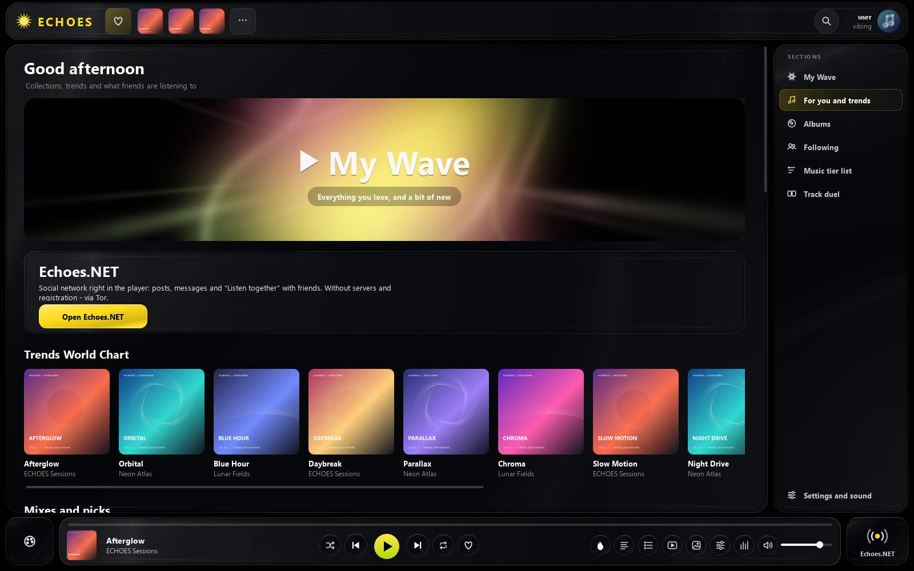
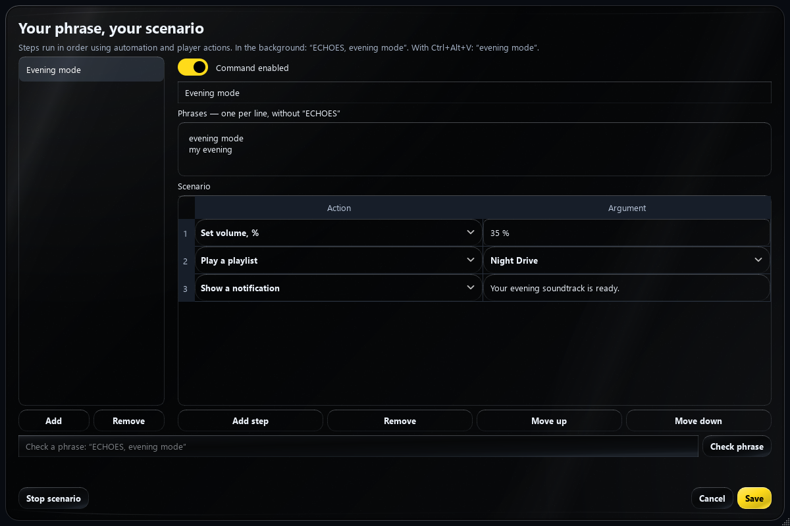
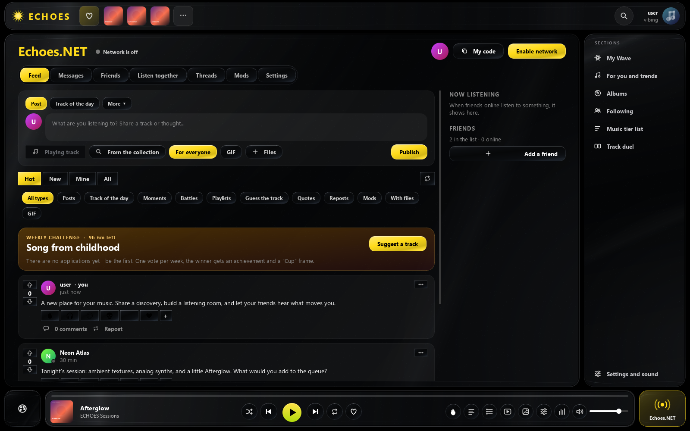
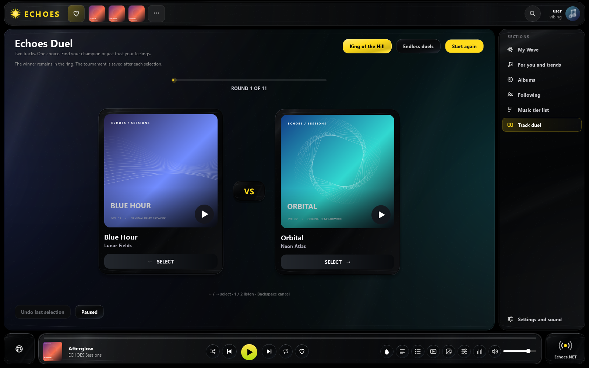
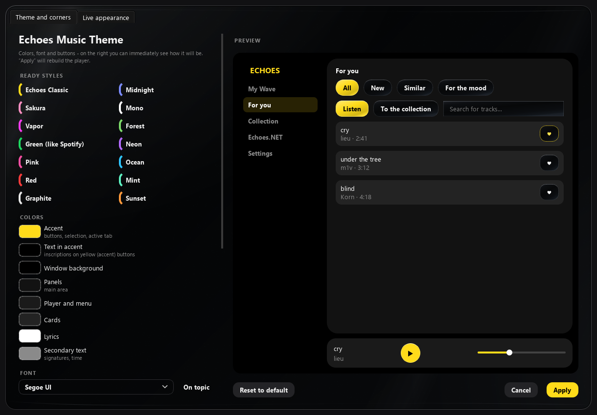
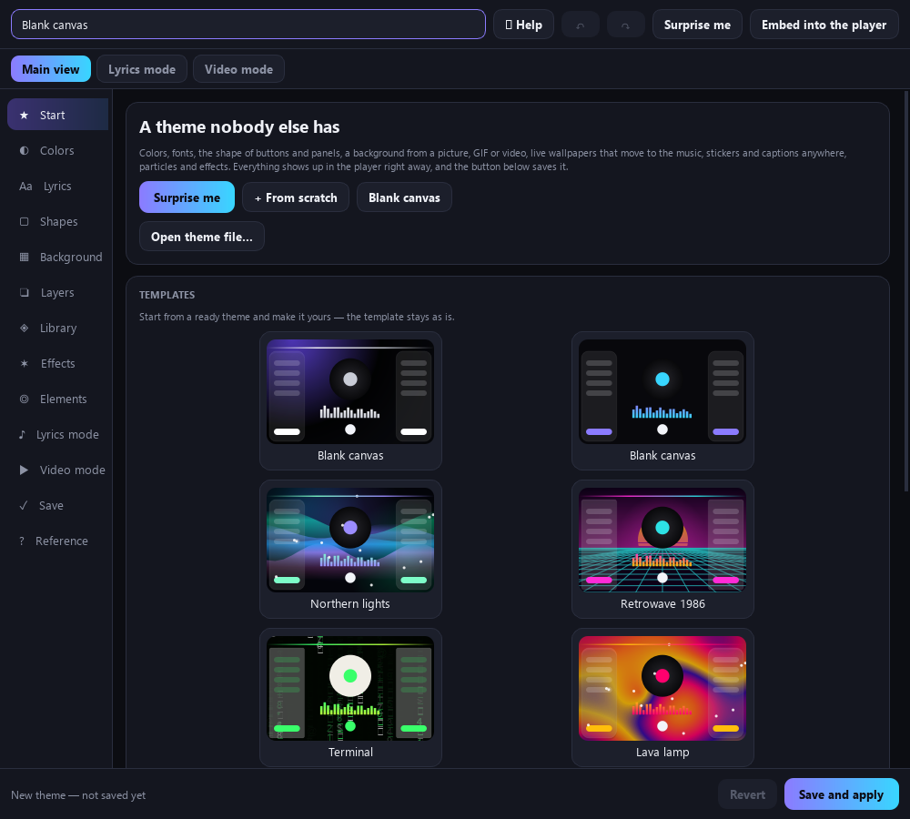
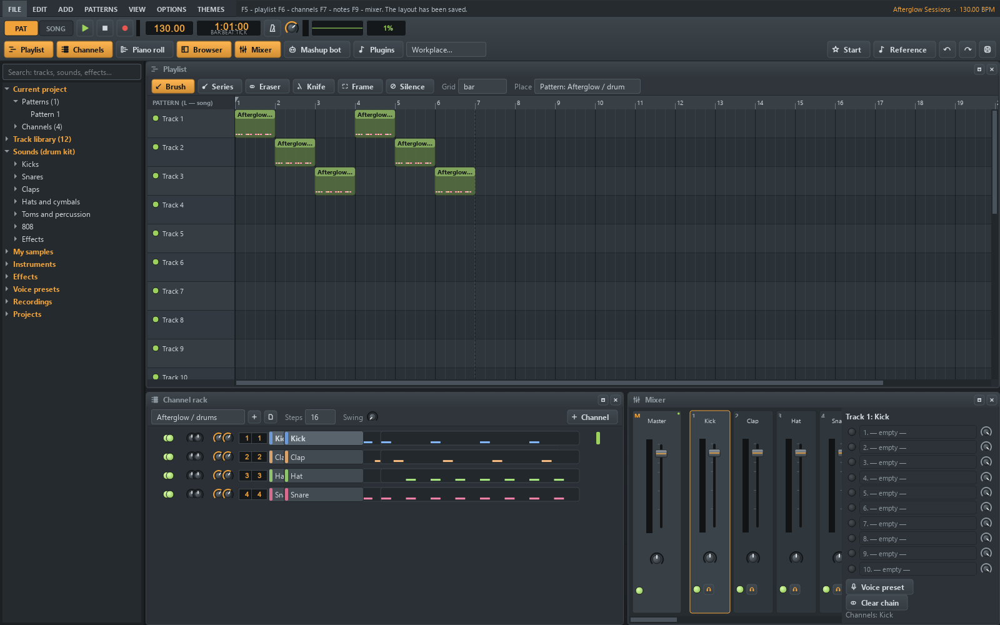
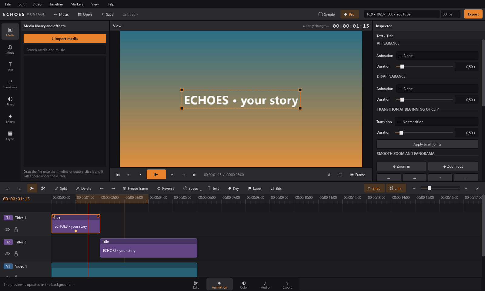

<h1 align="center">ECHOES</h1>

<strong>Your music. Your space.</strong> Listen, discover, connect, create, and play — in one Windows app.

<strong>English</strong> · <a href="README.ru.md">Русский</a> Windows 10 / 11 x64 · Python + Qt · Native C++ audio, effects & video editor

ECHOES brings a music library, endless recommendations, a peer-to-peer social network, a music studio, a native video editor, a rhythm game, and a programmable theme designer into the same app. Its Echoes Music interface combines dark liquid glass, hand-drawn symbols, animated artwork, and an unmistakable yellow accent.

**Start here:** [Install](#install) · [Features](#features) · [Screenshots](#screenshots) · [Development](#development) · [Publish this repository](docs/PUBLISH.md) · [License](#license)

## Install

1. Download the repository with **Code → Download ZIP**, then extract the **entire** archive.
2. Run **`Install ECHOES.bat`**. It installs a private Python runtime, libraries, VLC, FFmpeg, and shortcuts without administrator access.
3. Launch ECHOES from the desktop or Start menu. A new profile starts in **English**. Russian is available in Settings → Language; restart to apply a language change.

To update an existing installation, close ECHOES, including its tray icon, and run **`Update ECHOES.bat`** from the new download. The local launcher can also apply an unpacked update and retain the previous app version. Your library, playlists, and settings live separately from program files.

Russian installer entry points are included as `УСТАНОВИТЬ ECHOES.bat` and `ОБНОВИТЬ ECHOES.bat`. The first installation needs an internet connection. Online discovery, downloads, social connections, and optional AI models have their own network or dependency requirements; local playback does not need an online account.

## Features

### Music, discovery, and your collection

- **Local library:** artwork, tags, search, albums, artist pages, favorites, playlists, queue editing, shuffle, repeat, and playback history.
- **My Wave:** an ongoing mix of familiar music and discoveries, with controls for mood, activity, language, and how much unfamiliar music to include. Artist and genre waves offer another route through your taste.
- **For you:** charts, recommendations from your collection and listening history, artist suggestions, new releases, and followed artists.
- **Online search and streaming:** discover music through supported online sources, prepare upcoming streams, and download tracks or albums from supported services. Import Spotify playlists and share playlists with other ECHOES users.
- **Library care:** tag and cover lookup, genre analysis and corrections, track tools, duplicate/cache cleanup, listening statistics, a profile, and Wrapped-style listening recaps.

### Sound and focused listening

- VLC playback plus an optional native audio output and mixer; gapless/crossfade controls, volume normalization, equalizer presets, bass and stereo controls.
- Speed, pitch, slowed/reverb processing, sound-scene controls, headphone EQ profiles, and DSP export tools.
- A listening workbench with **A/B fragments and loops, timestamp bookmarks, EQ comparison, tap BPM, sleep/track routines, and a listening diary**.
- Mini player, global shortcuts, media keys, Windows media integration, tray controls, configurable animation FPS, and Discord Rich Presence.

### Lyrics, videos, and visualizers

- Find lyrics, display synchronized lines and words, edit `.lrc` timing, verify lyrics, and optionally generate alignment with a local speech model.
- Find a music video for the current track, synchronize it with playback, and mix music and video sound separately.
- Animated covers, vinyl views, cover mode, audio-reactive backgrounds, visualizers, MilkDrop-style effects, and a configurable streaming overlay with its own layout editor.

### Voice commands and automation

- **Russian and English voice control** with a wake word or push-to-talk shortcut. Speech recognition runs locally with a compatible installed faster-whisper model.
- Speech gating, strict command matching, and confidence checks help reject background sound and unintended phrases. Model work runs away from the interface thread.
- Create **your own phrases and multi-step scenarios**: start My Wave, play a playlist or artist, set volume, pause/resume, skip, like, shuffle, switch the mini player, wait, or display a notification.
- Use the visual scenario editor to reorder steps and test phrases before saving. Up to 100 commands, 12 phrase variants per command, and 40 steps per scenario.
- **Automation rules:** react to a schedule, app startup, a game starting/closing, or a friend coming online. Start music, lower volume while gaming, pause, or show a notification.

### Echoes.NET — a social space inside your player

- **Peer-to-peer connections:** Tor-based identities, direct connection options, local-network discovery, and relay/discovery integrations. Connection availability depends on the chosen transport and network.
- **Conversations:** private and group chats, replies and threads, files, photos, videos, GIFs, voice messages, and voice calls. Photo/video previews can open in larger resizable windows.
- **Feed:** posts, comments, polls, track sharing, emoji reactions, moments, and time capsules.
- **Listen together:** synchronized listening rooms, shared queues, collaborative playlists, radio broadcasts, and what friends are listening to now.
- **Music with friends:** taste compatibility, an interactive taste map, music quizzes, live quizzes, challenges, weekly rankings, and achievements.
- **Make it yours:** profiles, avatars, banners, frames, badges, gifts, showcases, and a community market for appearance items and themes.
- Moderation tools, notifications, device synchronization, backups, and update sharing round out the network features. Encrypted relayed message envelopes are implemented separately from public posts.

### Track duels and music tier lists

- **Echoes Duel:** two covers enter the arena; preview either track and pick a winner. Play King of the Hill or endless pairs, undo a vote, and keep a tournament across sessions.
- Add online contenders, inspect the leaderboard, and play your winners.
- **Music tier list:** organize tracks visually into ranked rows, adjust the board, and save/share the result.
- Cached artwork, effects, and monitor-aware animation timing keep the duel arena economical to draw.

### Liquid glass and a theme that belongs to you

- Switch between **Echoes Music, Vinyl glass, Fluid, Fluid Dark, Winamp**, and custom themes. Echoes Studio, Montage, and esu! provide their own workspaces.
- Echoes Music combines **appearance and live decoration** in one editor: palettes, fonts, buttons, panel corners, backgrounds, and animated details.
- Adjust **button rounding and interface rounding independently**. Tune layout, window proportions, scaling, artwork, and motion.
- Drawn interface symbols are provided by ECHOES; social reactions keep their expressive emoji.
- Resizable in-app panels and media previews, cached transitions, and resize previews help large interfaces remain responsive.

| Echoes Music appearance | Visual theme designer |
| --- | --- |
|  |  |

### Theme designer and EchoScript

- Design directly over the player: move, resize, rotate, and layer artwork, text, GIFs, video, particles, and interactive widgets.
- Start from live template previews, generate a variation with **Surprise me**, extract a palette from an image, check contrast, and import a font.
- Separate layouts for the main player, lyrics, and video modes; undo/redo and live previews make experimentation easy.
- Import/export `.echoestheme` packages with their assets; remove image backgrounds locally.
- **EchoScript** adds a code editor, syntax highlighting, visual building blocks, documentation, audio input, shapes, and programmable animated layers.

### Echoes Studio — make music without leaving ECHOES

- A pattern playlist, step sequencer/channel rack, piano roll, sample browser, and mixer with a master bus and 20 inserts.
- Built-in synths and sample instruments, drum kits, FM and wavetable tools, 808s, sample editing, velocity, panning, and instrument presets.
- Effect chains with EQ, compression, limiting, reverb, delay, distortion, autotune, vocoder, and voice presets.
- Microphone recording, project history, audio export, and configurable workspace arrangements.
- **Mashup bot:** combine vocals and an instrumental, adjust tempo and pitch, separate sources, or break a beat into usable sounds. Optional AI tools require their corresponding models/dependencies.

### ECHOES Montage — native video editing

- A **C++20 / Qt** editor embedded in ECHOES, with simple/pro modes, a multitrack timeline, real video thumbnails, audio waveforms, and background preview generation.
- Import video, audio, and images; separate linked audio/video, move and trim clips, split, duplicate, ripple-delete, snap, lock/mute tracks, and undo edits.
- Titles, automatic subtitles, position/scale/rotation, keyframes, easing, transitions, filters, masks, stabilization, reverse, freeze frame, and speed controls.
- Color and audio inspectors, scopes, export presets, aspect ratios, frame rates, selected ranges, and FFmpeg rendering.
- The native editor follows the player's English/Russian language selection. Its source and build script are included under `tools/montage/`.

### esu! — turn your library into a rhythm game

- Generate playable beatmaps from music analysis: tempo, beats, sections, drum attacks, melody, and sustained notes.
- Import osu! beatmaps and skins (`.osz`, `.osk`), use mods, customize hitsounds and HUD layout, and play with your preferred cursor settings.
- A beatmap editor, local rankings, attempts, replays, and pause/results screens are built in.

### Backups and everyday control

Export an `.echoesbackup` archive with settings, playlists, favorites, history, themes, and your Echoes.NET identity. Restore it on a later launch; caches are rebuilt instead of packed. Device synchronization, a local updater, output-device selection, keyboard shortcuts, window snapping, and interface scaling support day-to-day use.

## Screenshots

All screenshots show **real application widgets** rendered with a temporary offline demonstration profile. Cover art, track names, and social posts are original demo content. Discovery entries are fixture data, not claims about a live chart. No personal account, chats, keys, or music files are included.

[Music collection](docs/screenshots/music.png) · [Discovery](docs/screenshots/discover.png) · [Network](docs/screenshots/network.png) · [Duel](docs/screenshots/duel.png) · [Appearance](docs/screenshots/appearance.png) · [Voice](docs/screenshots/voice.png) · [Designer](docs/screenshots/designer.png) · [Studio](docs/screenshots/studio.png) · [Montage](docs/screenshots/montage.png)

## Development

The primary target is **Windows 10/11 x64 and Python 3.12**. The installer is the easiest way to obtain private VLC/FFmpeg runtimes. For a development environment, install `app/requirements.txt`, make VLC and FFmpeg discoverable, and run `python app/main.py`. Optional features install additional packages or models as described in their dialogs.

| Path | Contents |
| --- | --- |
| `app/` | Python/Qt application and feature modules |
| `app/assets/` | Drawn-symbol font and static English translation catalogs |
| `app/dsl_themes/` | Included EchoScript themes |
| `app/montage_native/` | Native editor, matching runtime DLLs, plugins, and license notices |
| `launcher/` | Local launcher/update source |
| `setup/` | English and Russian install/update/uninstall scripts |
| `tools/native/` | C++ audio and visual-effect sources/build scripts |
| `tools/montage/` | C++ video-editor sources/build script |
| `qa/` | Regression tests and isolated UI smoke/screenshot scripts |
| `docs/` | Screenshots, publishing instructions, and release notes |

Run regression tests with `python -m unittest discover -s qa -p "test_*.py"` in an environment with the application's dependencies. UI smoke checks use a temporary profile and disable network connections. The native editor has `--self-test` and `--smoke-test` modes. Native builds use MSYS2 UCRT64; the launcher build additionally needs PyInstaller and psutil.

Translation catalogs are shipped locally. ECHOES does **not** contact a translation service to translate interface labels during use. Existing profiles keep their chosen language.

## License

ECHOES-authored source is available under the **[MIT License](LICENSE)**. Third-party software, fonts, runtime libraries, and optional models retain their own licenses; MIT does not relicense those components. In particular, the standard PyQt6 distribution uses GPLv3/commercial licensing. See **[Third-party notices](THIRD_PARTY_NOTICES.md)** for dependency and distribution details.
