

<h1 align="center">ECHOES</h1>

<strong>Твоя музыка. Твоё пространство.</strong> Слушай, находи, общайся, создавай и играй — в одном приложении для Windows.

<a href="README.md">English</a> · <strong>Русский</strong> Windows 10 / 11 x64 · Python + Qt · Нативные звук, эффекты и видеоредактор на C++

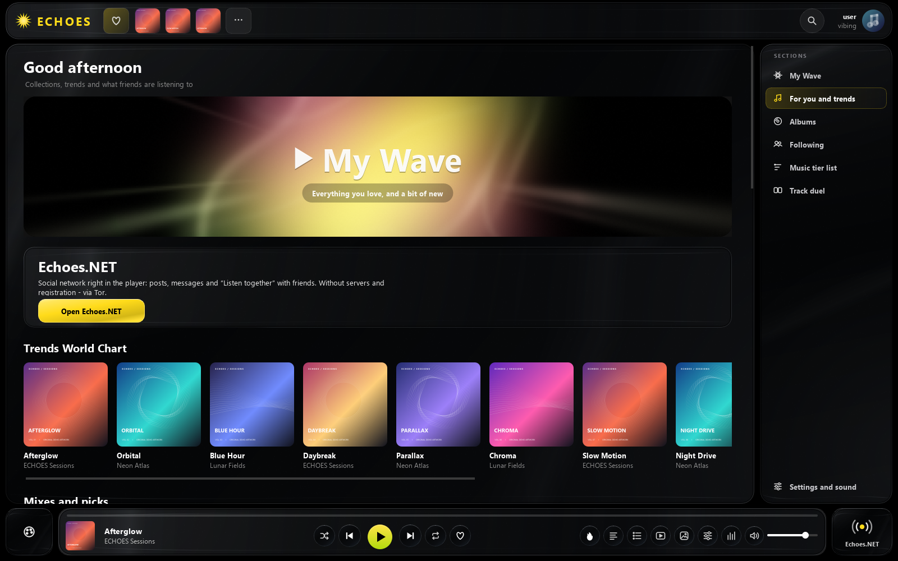

ECHOES объединяет музыкальную коллекцию, бесконечные рекомендации, одноранговую социальную сеть, музыкальную студию, нативный видеоредактор, ритм-игру и конструктор программируемых тем. В Echoes Music — тёмное жидкое стекло, нарисованные символы, живые обложки и узнаваемый жёлтый акцент.

**Навигация:** [Установка](#установка) · [Возможности](#возможности) · [Скриншоты](#скриншоты) · [Разработка](#разработка) · [Публикация на GitHub](docs/PUBLISH.md) · [Лицензия](#лицензия)

## Установка

1. Скачай репозиторий через **Code → Download ZIP** и распакуй **весь** архив.
2. Запусти **`УСТАНОВИТЬ ECHOES.bat`**. Установщик подготовит отдельный Python, библиотеки, VLC, FFmpeg и ярлыки без прав администратора.
3. Открой ECHOES с рабочего стола или из «Пуска». Новый профиль подстраивается под **язык системы**: русский для русской системы, английский для остальных. Сменить язык можно в настройках → «Язык / Language»: подписи обновляются сразу, музыка продолжает играть.

Для обновления закрой плеер, включая значок в трее, и запусти **`ОБНОВИТЬ ECHOES.bat`** из новой распакованной версии. Локальный лаунчер также умеет устанавливать обновление из папки и сохранять предыдущую версию приложения. Коллекция, плейлисты и настройки хранятся отдельно от файлов программы.

Для английского установщика есть **`Install ECHOES.bat`**, для обновления — **`Update ECHOES.bat`**. Первая установка требует интернета. Онлайн-поиск, загрузки, сеть и дополнительные ИИ-модели имеют свои требования к подключению и библиотекам; для локального воспроизведения интернет-аккаунт не нужен.

## Возможности

### Музыка, открытия и твоя коллекция

- **Медиатека:** обложки, теги, поиск, альбомы, страницы исполнителей, избранное, плейлисты, редактирование очереди, перемешивание, повтор и история.
- **Моя волна:** непрерывная смесь знакомой музыки и открытий. Настраивай настроение, занятие, язык и долю незнакомого; включай волны по исполнителю или жанру.
- **Для вас:** чарты, рекомендации по коллекции и прослушиваниям, похожие исполнители, новые релизы и подписки на артистов.
- **Онлайн-поиск и стриминг:** музыка из поддерживаемых источников, подготовка следующих потоков, загрузка треков и альбомов, импорт плейлистов Spotify и обмен плейлистами между пользователями ECHOES.
- **Порядок в коллекции:** поиск тегов и обложек, анализ и исправление жанров, инструменты треков, очистка дубликатов/кэшей, статистика, профиль и музыкальные итоги в стиле Wrapped.

### Звук и внимательное прослушивание

- Воспроизведение через VLC и дополнительный нативный аудиовыход с микшером; настройки бесшовного воспроизведения и переходов, нормализация, эквалайзер, бас и стерео.
- Скорость и высота тона, slowed/reverb, звуковая сцена, профили эквализации наушников и экспорт с обработкой.
- Панель прослушивания: **A/B-фрагменты и циклы, закладки с временем, сравнение EQ, tap BPM, сценарии сна/трека и музыкальный дневник**.
- Мини-плеер, глобальные сочетания, мультимедийные клавиши, интеграция с Windows, управление из трея, выбор FPS анимаций и Discord Rich Presence.

### Тексты, клипы и визуализация

- Поиск текстов, синхронные строки и слова, редактор времени `.lrc`, проверка текста и дополнительная локальная модель для автоматической синхронизации.
- Поиск клипа к текущей песне, синхронизация с музыкой и отдельный микшер звука клипа и трека.
- Живые обложки, виниловые представления, режим обложки, реагирующие на музыку фоны, визуализаторы, эффекты в духе MilkDrop и стрим-оверлей с собственным редактором расположения элементов.

### Голосовые команды и автоматика

- Управление голосом **на русском и английском** с обращением к ECHOES или сочетанием push-to-talk. Распознавание работает локально с установленной совместимой моделью faster-whisper.
- Проверка речи, строгий разбор команды и пороги уверенности помогают отсеивать фоновые звуки и случайные фразы. Работа модели вынесена из потока интерфейса.
- **Свои фразы и цепочки действий:** включить волну, плейлист или исполнителя; изменить громкость; поставить на паузу; продолжить; переключить трек; поставить лайк; перемешать; открыть мини-плеер; подождать; показать уведомление.
- В визуальном редакторе можно переставлять шаги и проверять фразы до сохранения. До 100 команд, 12 вариантов фразы на команду и 40 шагов в сценарии.
- **Автоматика:** правила по времени, запуску приложения, открытию/закрытию игры и появлению друга в сети. Включай музыку по расписанию, приглушай её во время игры и получай уведомления.

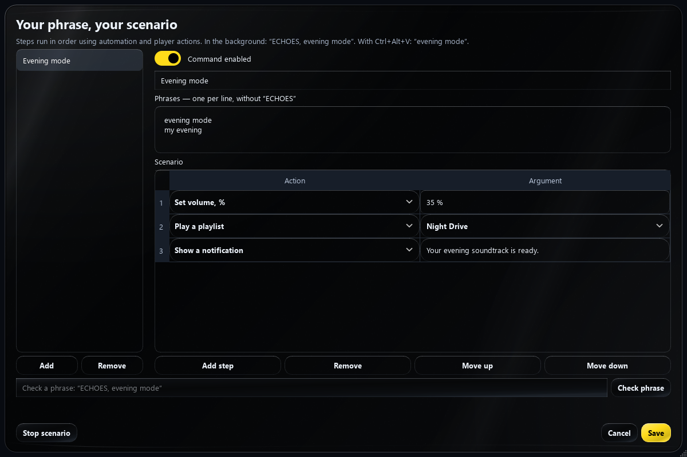

**Общие эффекты плеера:** раздел «Настройки → Звук» и маленькая кнопка звука в нижнем плеере используют одни значения баса, усиления и скорости/пресетов. Экспорт по умолчанию берёт их вместе с текущим EQ и реверберацией; отдельную настройку экспорта можно включить вручную. Эффекты радиомикрофона настраиваются отдельно.

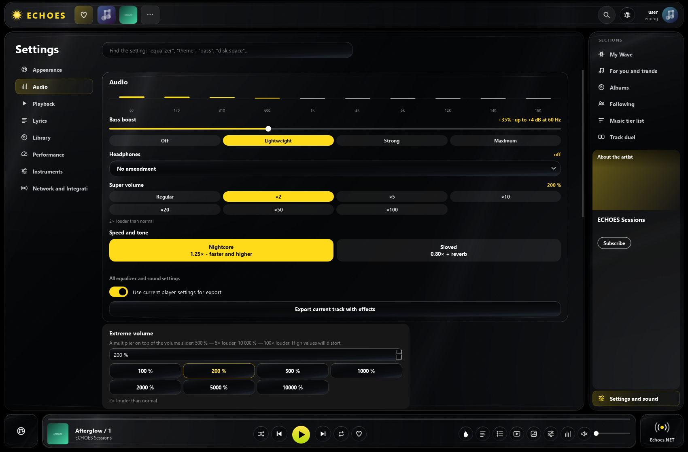

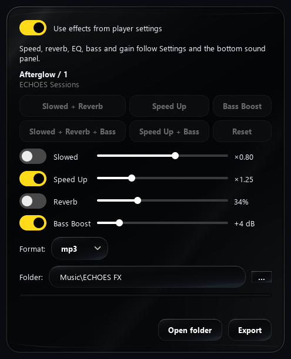

### Echoes.NET — общение прямо в плеере

- **Одноранговые соединения:** идентичности через Tor, варианты прямого подключения, поиск в локальной сети и механизмы ретрансляции/обнаружения. Доступность связи зависит от выбранного транспорта и сети.
- **Переписка:** личные и групповые чаты, ответы и ветки, файлы, фото, видео, GIF, голосовые сообщения и голосовые звонки. Предпросмотры фото/видео можно открывать в больших растягиваемых окнах.
- **Лента:** публикации, комментарии, опросы, треки, реакции-смайлики, моменты и капсулы времени.
- **Слушайте вместе:** синхронные комнаты, совместные плейлисты и музыка друзей прямо сейчас.
- **Своя радиостанция:** публичные название и аватар, видимые слушателям и в каталоге эфиров. Собирай отдельную эфирную очередь из коллекции/плейлистов, перетаскивай треки, редактируй в эфире, ставь паузу, переключай и включай повтор. Расписание эфира работает независимо от личного плеера ведущего. Гости видят очередь и слушают эфирный трек. Удерживай кнопку, чтобы говорить в эфир. До 100 треков с известной длительностью; слушатели используют свою коллекцию, поддерживаемый поток или файл ведущего при разрешённой передаче и доступном прямом соединении.
- **Облачко эффектов голоса:** автотюн с выбором тональности/лада, питч, форманта, робот/вокодер, эхо, реверб, хорус/двойной голос, насыщение/перегруз, тремоло, биткрашер, телефонный фильтр и компрессор ведущего. Двенадцать пресетов и свои сочетания. Обработка идёт до отправки, на отдельном голосовом движке радиостанции, независимо от личных звонков.
- **Звуки в эфире:** до 16 аудиофайлов, каждый до 30 секунд и 10 МиБ. Запускай и останавливай их без удержания микрофона, меняй громкость; текущие слушатели могут скачать оригиналы. Короткие файлы декодируются в фоне, звук передаётся по доступному голосовому каналу станции.
- **Проверенные ведущие:** отправляй заявку администратору или модератору. Разрешение подписывается и может быть отозвано; профиль станции и публичные объявления проверяются по подтверждённым ролям. Сотрудники могут также выдать/отозвать разрешение в меню модерации профиля.
- **Запросы и баги:** отдельная вкладка для ошибок, заявок на радио, апелляций и других обращений. Есть фильтры категорий, личная история, ответы сотрудников и кнопки одобрения/отклонения. Для ответа сотрудника включи Echoes.NET; сохранённые ответы повторяются до подтверждения доставки.
- **Музыкальные знакомства:** совместимость вкусов, интерактивная карта вкусов, викторины и живые квизы, челленджи, недельные рейтинги и достижения.
- **Оформление:** профили, аватарки, баннеры, рамки, значки, подарки, витрины и рынок оформления/тем.
- Модерация, уведомления, синхронизация устройств, резервные копии и передача обновлений. Для сообщений через посредника предусмотрены зашифрованные конверты; публичные публикации устроены отдельно.

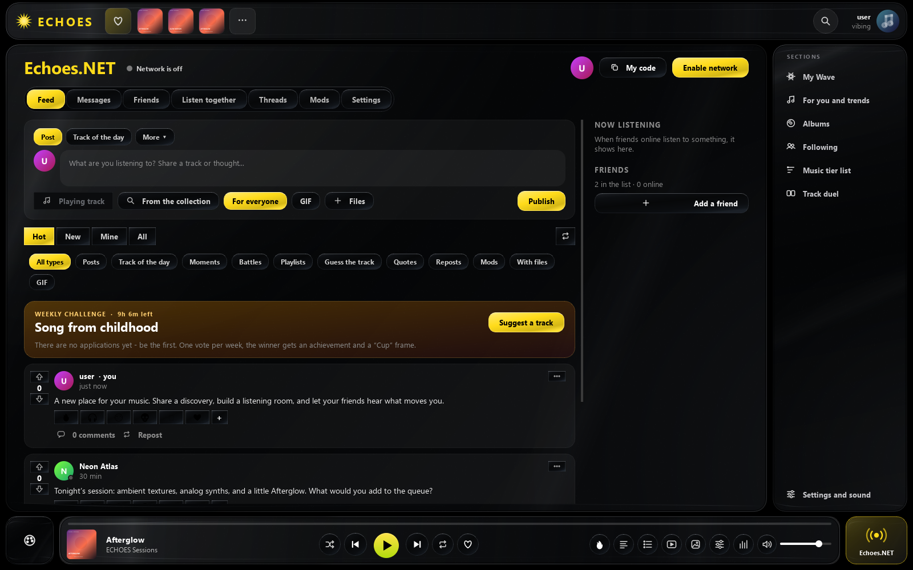

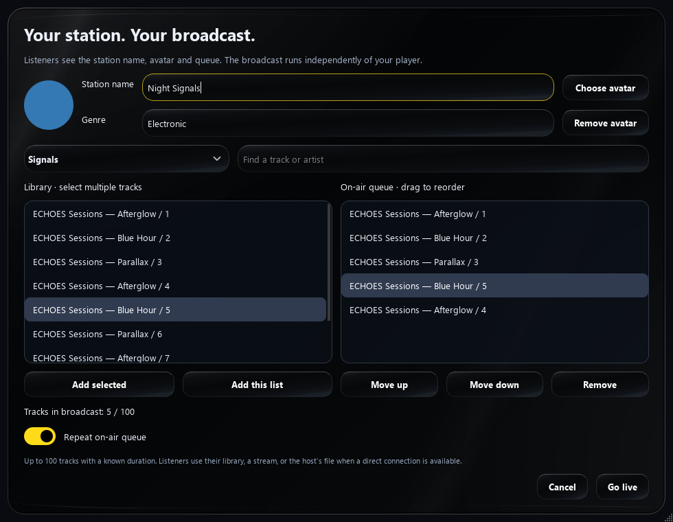

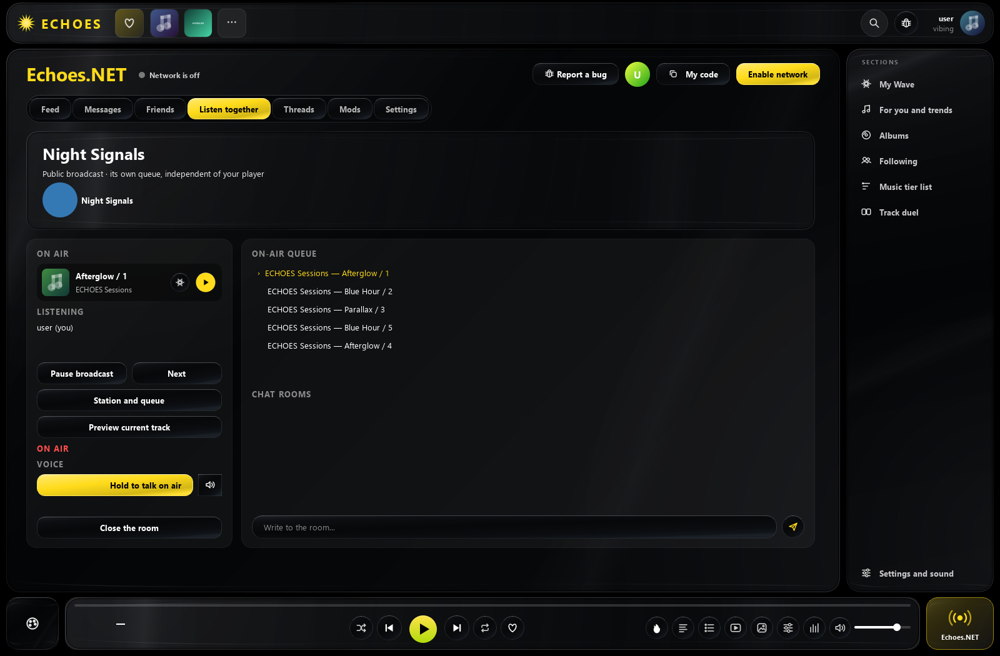

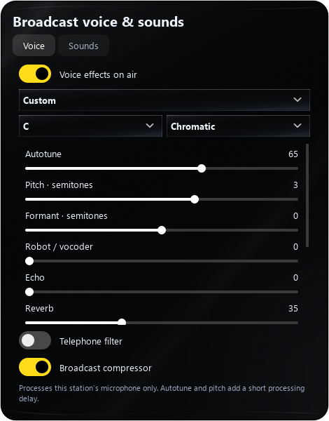

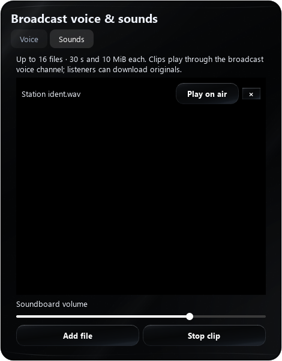

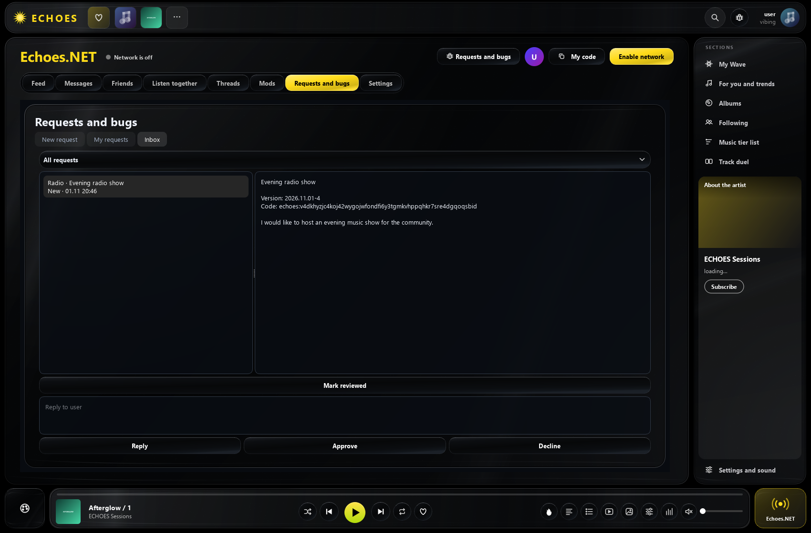

### Дуэли треков и музыкальные тир-листы

- **Echoes Duel:** послушай двух соперников и выбери победителя. Режимы «Царь горы» и бесконечных пар, отмена голоса и сохранение турнира между запусками.
- Добавляй соперников из интернета, смотри лидеров и включай победителей.
- **Настройки дуэли:** сочетай фильтры по жанру, исполнителю, альбому, плейлисту, избранному и длительности для следующего турнира.
- **Начало с припева включено по умолчанию.** Один фоновый обработчик использует готовый анализ или ищет энергичную повторяющуюся часть. Если припев определить не удалось, выбирается яркий фрагмент или начало; интерфейс не ждёт анализа в своём потоке.
- **Аура за победы:** уровни на **5, 10, 20, 35, 50 и 100 победах** открывают изумрудный, синий, фиолетовый, розовый, огненный и ледяной цвета. До первого уровня пламени нет. Полупрозрачное пламя и искры рисуются в родном разрешении прямо от скруглённых краёв карточки, без растянутой текстуры и прямоугольной поверхности ауры. Ограниченный кэш хранит небольшие наборы параметров и освобождается при скрытии.
- **Музыкальный тир-лист:** раскладывай треки по уровням, настраивай таблицу, сохраняй результат и делись им.
- Обложки и эффекты арены кэшируются, а анимации используют общий таймер с учётом экрана.

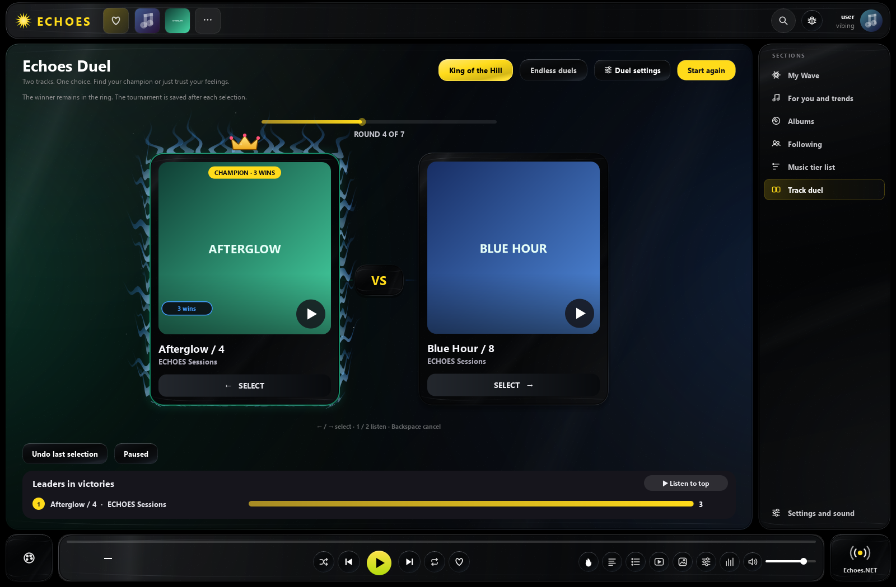

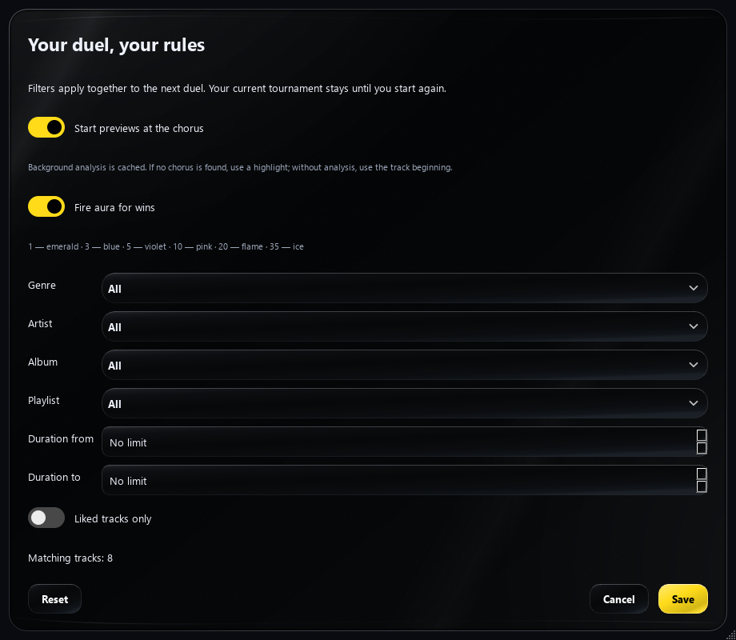

### Производительность — настрой свой баланс

В **Настройки → Производительность** появились три вкладки: кадры/движение, бюджеты памяти и эффекты/фоновые задачи. Есть пресеты **«Баланс»**, **«Меньше ОЗУ»**, **«Плавность»** и ручная настройка:

- FPS активного и фонового окна, адаптация под нагрузку, профиль движения и переходы интерфейса.
- Отдельные лимиты МиБ для обложек, **общего** кэша строк треков, кнопок, изображений Qt и ауры.
- Освобождение скрытых страниц, предел разрешения фото/GIF, детализация ауры и дополнительное конфетти.
- Анимация аватарок/GIF, сохранение всех кадров GIF, прогрев страниц, предварительный анализ припева и его временной бюджет.
- Аппаратное декодирование видео, нативные эффекты, кнопка освобождения кэшей и текущие показатели рабочей/приватной памяти.

По умолчанию все кадры GIF не удерживаются, а скрытые страницы заранее не прогреваются. Анализ припева обрабатывает небольшие пачки FFT-окон, закрытый предпросмотр фото освобождает декодированное изображение. Маленькие кэши экономят память; большие могут ускорить повторную прокрутку на экранах высокого разрешения.

В отдельной проверке Windows **400 изображений строк 1440 × 56** старый кэш удерживал **123,05 МиБ**, новый общий кэш — **12 МиБ**. Прирост приватной памяти в этом тесте снизился с **125,39 до 14,02 МиБ**. Это измерение конкретного кэша, а не обещание такого расхода всей программы со всеми студиями и моделями. [Проверка версии](docs/VALIDATION.md).

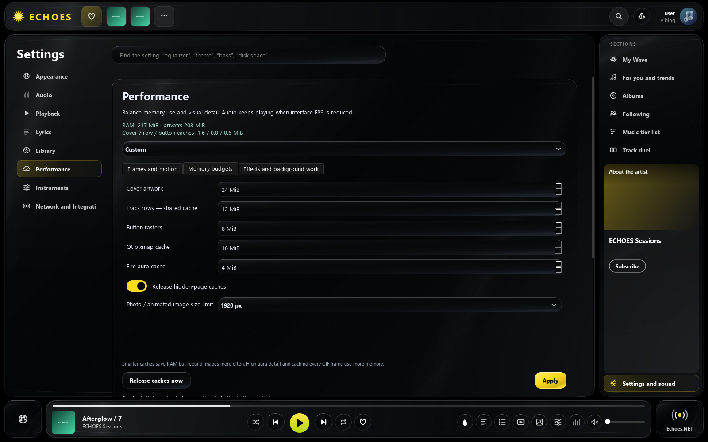

### Личные баг-репорты команде

Нажми нарисованную **кнопку с жуком сверху** или **«Сообщить об ошибке»** в Echoes.NET. Выбери администратора/модератора с подтверждённой ролью, укажи тему, описание и при желании шаги повторения. Добавлять получателя в друзья не требуется. Репорт видит выбранный получатель; логи и файлы автоматически не прикладываются.

Офлайн-репорты сохраняются в очереди. В **«Мои репорты»** различаются ожидание и подтверждённое получение; повторы доставки можно отменить. У команды есть входящие и отметка просмотра. Обоим участникам нужна версия с поддержкой протокола репортов; без подтверждения сообщение не обозначается доставленным.

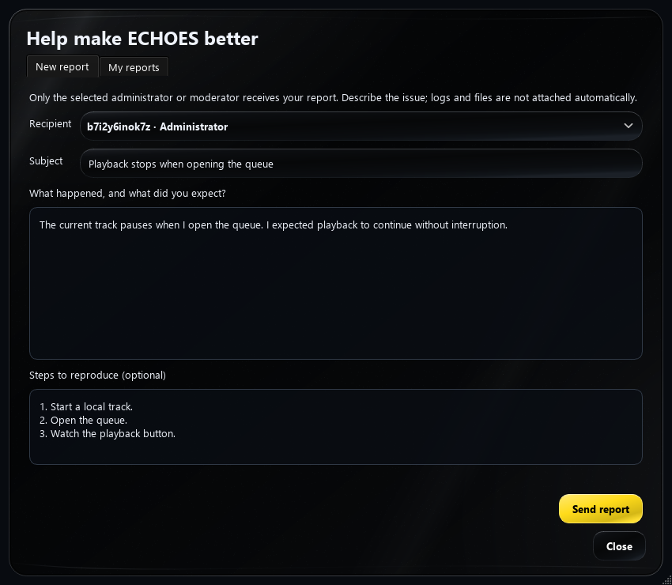

### Жидкое стекло и личное оформление

- Темы **Echoes Music, Vinyl glass, Fluid, Fluid Dark, Winamp** и собственные варианты. Echoes Studio, Montage и esu! открывают отдельные рабочие пространства.
- В Echoes Music **тема и живое оформление объединены**: палитры, шрифты, кнопки, скругления панелей, фоны и анимированные детали настраиваются в одном редакторе.
- **Скругление кнопок и скругление интерфейса независимы.** Есть настройки расположения, пропорций окна, масштаба, обложек и движения.
- Для элементов управления используются нарисованные символы ECHOES, а реакции в общении остаются смайликами.
- Растягиваемые панели и вложения, кэшированные переходы и предпросмотр изменения размера помогают интерфейсу оставаться отзывчивым.

| Оформление Echoes Music | Конструктор тем |
| --- | --- |
| 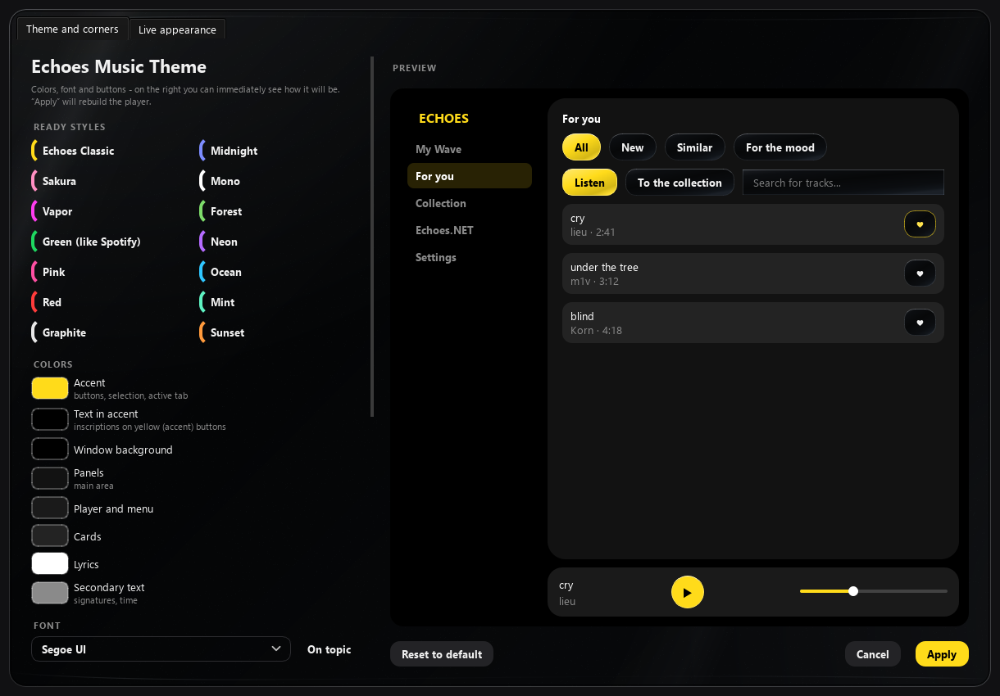 | 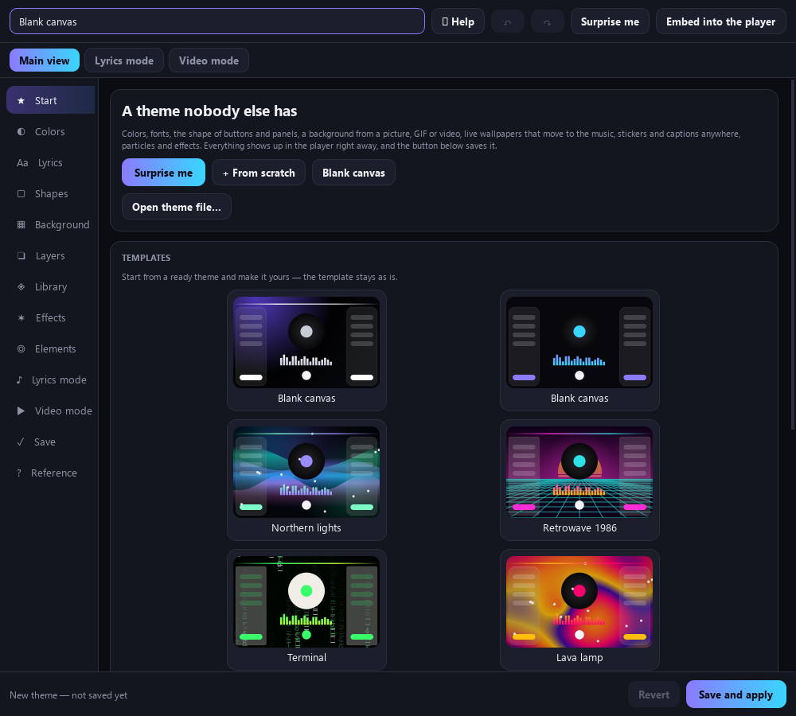 |

### Конструктор тем и EchoScript

- Редактируй прямо поверх плеера: двигай, растягивай, поворачивай и размещай слоями картинки, подписи, GIF, видео, частицы и интерактивные виджеты.
- Шаблоны с живыми миниатюрами, **«Удиви меня»**, палитра из изображения, проверка контраста и импорт шрифта.
- Отдельные виды для плеера, текста песни и клипа, отмена/повтор и живой предпросмотр.
- Импорт/экспорт `.echoestheme` вместе с ресурсами и локальное удаление фона изображения.
- **EchoScript:** редактор кода с подсветкой, визуальные блоки, справка, звуковые данные, фигуры и программируемые анимированные слои.

### Echoes Studio — создание музыки внутри ECHOES

- Плейлист паттернов, пошаговый секвенсор, стойка каналов, пианоролл, браузер сэмплов и микшер с мастер-шиной и 20 вставками.
- Синтезаторы и сэмплеры, драм-киты, FM и волновые таблицы, 808, редактирование сэмплов, сила нот, панорама и пресеты инструментов.
- Цепочки обработки: EQ, компрессор, лимитер, реверберация, задержка, искажения, автотюн, вокодер и голосовые пресеты.
- Запись микрофона, история проекта, экспорт звука и настраиваемые раскладки рабочего места.
- **Мэшап-бот:** совмести вокал и инструментал, подгони темп и высоту, раздели источники или разбери бит на звуки. Дополнительным ИИ-инструментам нужны соответствующие модели и библиотеки.

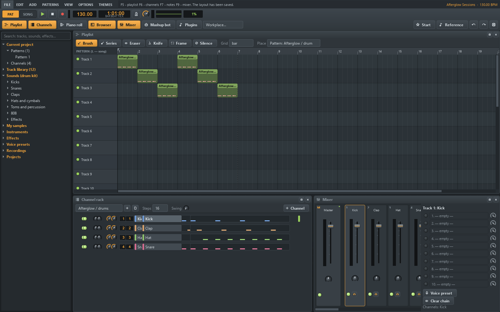

### ECHOES Montage — нативный видеоредактор

- Редактор на **C++20 / Qt** внутри плеера: простой и профессиональный режимы, многодорожечный таймлайн, настоящие миниатюры кадров, звуковые волны и подготовка предпросмотра в фоне.
- Импорт видео, аудио и изображений; связанные видео/звук и их разделение, перенос, обрезка, разрезание, дублирование, удаление со сдвигом, привязка, блокировка/отключение дорожек и отмена правок.
- Титры, автоматические субтитры, позиция/масштаб/поворот, ключевые кадры, плавность, переходы, фильтры, маски, стабилизация, реверс, стоп-кадр и скорость.
- Инспекторы цвета и звука, скопы, пресеты экспорта, пропорции, частота кадров, выбранный диапазон и рендер через FFmpeg.
- Редактор следует выбранному языку плеера. Исходники и сборка находятся в `tools/montage/`.

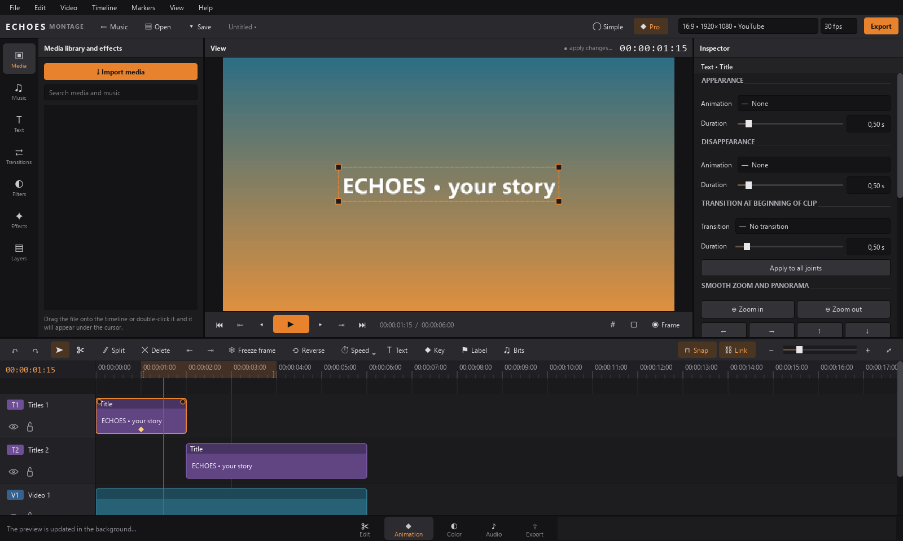

### esu! — ритм-игра из твоей коллекции

- Генерация карт по анализу музыки: темп, удары, части песни, атаки барабанов, мелодия и длинные ноты.
- Импорт карт и скинов osu! (`.osz`, `.osk`), моды, свои hitsounds, расположение HUD и настройки курсора.
- Редактор карт, локальные рейтинги, попытки, повторы и экраны паузы/результатов.

### Резервные копии и повседневные инструменты

Архив `.echoesbackup` сохраняет настройки, плейлисты, избранное, историю, темы и идентичность Echoes.NET. Восстановление применяется при следующем запуске, а кэши создаются заново. Есть синхронизация устройств, локальное обновление, выбор аудиоустройства, горячие клавиши, привязка окна и масштабирование интерфейса.

## Скриншоты

На изображениях — **настоящие виджеты приложения** с временным демонстрационным профилем без доступа к сети. Обложки, названия треков и посты созданы специально для демонстрации. Карточки рекомендаций заполнены тестовыми данными и не обозначают позиции настоящего чарта. Личные аккаунты, переписки, ключи и музыка в репозиторий не входят.

[Коллекция](docs/screenshots/music.png) · [Открытия](docs/screenshots/discover.png) · [Сеть](docs/screenshots/network.png) · [Дуэль](docs/screenshots/duel.png) · [Оформление](docs/screenshots/appearance.png) · [Голос](docs/screenshots/voice.png) · [Конструктор](docs/screenshots/designer.png) · [Студия](docs/screenshots/studio.png) · [Montage](docs/screenshots/montage.png)

## Разработка

Основная платформа — **Windows 10/11 x64 и Python 3.12**. Установщик проще всего подготавливает VLC и FFmpeg. Для разработки установи зависимости из `app/requirements.txt`, обеспечь доступ к VLC/FFmpeg и запусти `python app/main.py`. Дополнительные инструменты сообщают о необходимых пакетах и моделях в своих окнах.

| Папка | Содержимое |
| --- | --- |
| `app/` | Плеер и модули функций на Python/Qt |
| `app/assets/` | Шрифт нарисованных символов и английские словари |
| `app/dsl_themes/` | Встроенные темы EchoScript |
| `app/montage_native/` | Нативный редактор, библиотеки, плагины и лицензии |
| `launcher/` | Исходники локального лаунчера и обновления |
| `setup/` | Установка, обновление и удаление на двух языках |
| `tools/native/` | C++-исходники аудио и визуальных эффектов |
| `tools/montage/` | C++-исходники и сборка видеоредактора |
| `qa/` | Регрессионные тесты, проверки интерфейса и создание скриншотов |
| `docs/` | Скриншоты, публикация и изменения версии |

Проверки: `python -m unittest discover -s qa -p "test_*.py"` в окружении с зависимостями приложения. Проверки интерфейса используют временный профиль и блокируют сеть. У Montage есть режимы `--self-test` и `--smoke-test`. Нативные модули собираются через MSYS2 UCRT64; для сборки лаунчера дополнительно нужны PyInstaller и psutil.

Словари входят в приложение: ECHOES **не обращается к сервису перевода** для показа надписей. Уже существующие профили сохраняют выбранный язык.

## Лицензия

Авторские исходники ECHOES доступны по **[MIT License](LICENSE)**. Сторонние библиотеки, шрифты, компоненты среды и дополнительные модели сохраняют собственные лицензии: MIT их не заменяет. В частности, обычная поставка PyQt6 использует GPLv3/коммерческое лицензирование. Подробности — в **[THIRD_PARTY_NOTICES.md](THIRD_PARTY_NOTICES.md)**.

Импорт из Яндекс Музыки и VK находится рядом со Spotify в настройках медиатеки. Токены не запрашиваются: используются публичные списки или TXT/M3U. Если сервис требует вход либо отдаёт неполный список, импорт сообщает об ограничении.
